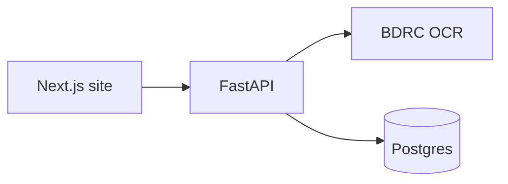

# Butter Dots Dot Com

Tibetan language resources for the Orgyen Khandroling Sangha. The site is a
spellchecker for text and PDFs, plus short guides for reading and typing
Tibetan.

## Features

- **Spellcheck.** Paste Tibetan text, or upload a PDF. Structural errors
  follow traditional syllable rules. Words absent from the attested corpus are
  warnings. Digital PDFs are read from the text layer. Microsoft Himalaya
  PDFs and scans go through the BDRC OCR engine.
- **Learn.** Guides at `/learn` for spelling rules, sentence structure, and
  typing Tibetan.
- **Interactive OCR.** `/interactive-ocr` is a waitlist. The tool is not on
  the public site.

## Architecture



`backend/BDRC/` is a vendored copy of
[buda-base/tibetan-ocr-app](https://github.com/buda-base/tibetan-ocr-app)
(MIT). See `backend/BDRC/UPSTREAM.md`. Decisions are in
[docs/adr/SPELLCHECKER_DECISIONS.md](docs/adr/SPELLCHECKER_DECISIONS.md).

| Change | Where |
| --- | --- |
| Pages | `frontend/pages/` |
| Components | `frontend/components/` |
| API | `backend/app/api/` |
| Spellcheck rules | `backend/app/spellcheck/` |
| PDF and OCR | `backend/app/pdf/` |
| Schema | `database/schema.sql` |

## Quickstart

Docker Desktop runs the frontend, backend, and database.

```bash
git clone https://github.com/stellakunzang/butter-dots-dot-com.git
cd butter-dots-dot-com
cd backend && python3 scripts/download_models.py && cd ..
docker compose up
```

- App: http://localhost:3000
- API: http://localhost:8000/docs

The first build takes a few minutes. Stop with `Ctrl+C`.

Without Docker, deploy steps, and troubleshooting:
[docs/guides/LOCAL_DEVELOPMENT.md](docs/guides/LOCAL_DEVELOPMENT.md) and
[docs/guides/DEPLOYMENT.md](docs/guides/DEPLOYMENT.md).

Tests:

```bash
cd backend && venv/bin/pytest -m "not slow"
cd frontend && yarn test:ci
```

The OCR parity suite is separate. Run it when changing `backend/BDRC/` or
`backend/app/pdf/`. See
[docs/planning/OCR_PARITY_BASELINE.md](docs/planning/OCR_PARITY_BASELINE.md).

## Layout

| Path | What |
| --- | --- |
| `frontend/` | Next.js site |
| `backend/` | FastAPI spellchecker and PDF pipeline |
| `database/` | Postgres schema and migrations |
| `docs/` | ADRs, guides, and working notes |

The doc index is [docs/README.md](docs/README.md).

## Acknowledgments

Syllable rules derive from Paul G. Hackett's Tibetan Spell-checker v1.0
(Columbia University, 2011), written in VBA for Microsoft Word and released
under GPL v3. The invalid-pattern approach was ported to Python. See
[docs/research/SCRIPT_ANALYSIS.md](docs/research/SCRIPT_ANALYSIS.md) and
[THIRD_PARTY_NOTICES.md](THIRD_PARTY_NOTICES.md).

PDF OCR uses the BDRC Tibetan OCR engine by Eric Werner and the Buddhist
Digital Resource Center, with the Monlam AI team, under the MIT license.
Models were trained on transcriptions from BDRC, the Asian Legacy Library,
Adarsha, and NorbuKetaka.

- [buda-base/tibetan-ocr-app](https://github.com/buda-base/tibetan-ocr-app)
- [Hugging Face / BDRC](https://huggingface.co/BDRC)
