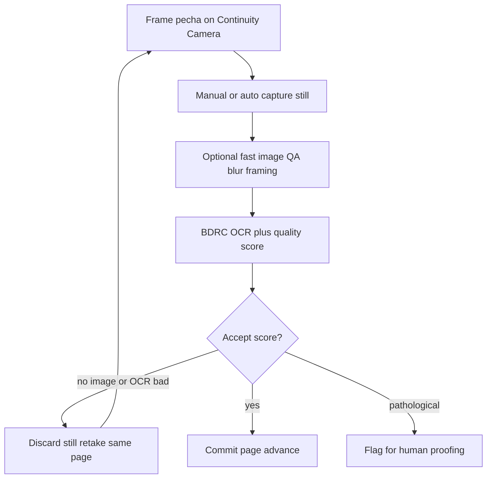

# Live Pecha Capture (Continuity Camera → OCR)

**Status:** Spike in progress — [#79](https://github.com/stellakunzang/butter-dots-dot-com/issues/79). Not ticketed for a product capture UI.  
**Companion to:** [INTERACTIVE_OCR_PLAN.md](INTERACTIVE_OCR_PLAN.md)  
**Continue here:** [Spike notes, 2026-11-04](#spike-notes-2026-11-04).  
**Goal:** Document a frictionless page-by-page capture loop for physical pecha, learn Continuity Camera + per-page OCR latency via a spike, then decide whether to ticket a product UI.

---

## Usecase

You have a physical pecha (often 200+ pages) that needs to become a workable digital file (DOCX / spellchecked text). Today the efficient-looking path is inefficient in practice:

1. Photograph each page on iPhone  
2. Save to Photos / sync via iCloud  
3. Open on Mac  
4. Upload one-by-one (or assemble a PDF offline)

That handoff dominates the session. You already use the iPhone as a Zoom webcam from the Mac — that feature is **Continuity Camera**. The proposed product path is: open the app on the Mac, select the iPhone camera in-browser, capture stills from the live stream, run OCR, and never touch the Photos library.

**Success shape for a book:**

- Most pages: BDRC accepts on the first good frame (local ONNX, no LLM cost).  
- Small percentage: text is special (warped, faded, mixed script, unusual layout) → flag for human proofing in `/ocr-assist`.  
- Bad frames: retake **the same page** immediately before advancing.

This is the “physical-book photos” future item from the interactive OCR plan, made concrete for Apple Continuity Camera + a live OCR gate.

---

## Decisions (v1)

| Decision | Choice |
| -------- | ------ |
| Device handoff | Continuity Camera → Mac browser `getUserMedia` (not Photos / iCloud / manual upload). **Safari only for now** — Chrome does not list the iPhone |
| Line fit | Three fixes in the vendored pipeline (they also run in production): frame-rule whitening above line 1, a first-line top bound of one median line gap, and a white margin when a line's ink would fill >95% of the 100-row window. Guarded by the `pecha-photo-*` golden fixtures. See [Spike notes, 2026-11-04](#spike-notes-2026-11-04) |
| Advance gate | **Live OCR gate** — wait for BDRC + quality score on the current page before flipping to the next |
| Pipelining | **Not in v1** — no “frame next while OCR last” (easy to confuse when holding a pecha) |
| Still source | Freeze frame / shutter from the video stream, not a file from the Photos library |
| Escalation | Human proofing in the slimmed `/ocr-assist` (edit, rotate, retry with a chosen BDRC model). No vision or diagnostician — removed in [CODE_REVIEW_FIXES.md](CODE_REVIEW_FIXES.md) B1 |
| Autocapture | Optional after spike proves framing + stability heuristics; not required for first spike |

---

## Proposed v1 loop (live OCR gate)

### Loop details

1. **Frame** — iPhone aimed at the pecha leaf; Mac shows live preview.  
2. **Capture** — grab a high-res still from the stream (canvas draw or `ImageCapture` when available).  
3. **Image QA (optional, pre-OCR)** — blur / crop / guide-overlay checks can reject a frame *before* OCR so you don’t burn seconds on an obviously bad shot. This is a retake *hint*, not the advance gate.  
4. **OCR** — BDRC + quality scorer (same thresholds / settings model as interactive OCR).  
5. **Decide on this page only**  
   - Accept → commit page, advance.  
   - Bad image or recoverable OCR fail → discard still, retake.  
   - Pathological → flag for human proofing, then continue.  
6. Repeat until the book is done → DOCX export (existing T-08 path once wired).

### Mapping onto existing architecture

Interactive OCR already thinks in per-page images under the job store (`jobs/<id>/page-NNN/image.png`, settings, attempts). Live capture should:

| Capture action | Job store action |
| -------------- | ---------------- |
| New page still | Write / replace `image.png` for page N |
| Retake | Replace image, clear or append attempt, re-run `run_page` |
| Accept | Finalize page, `N → N+1` |
| Escalate | Mark page for human proofing (existing accept / edit / retry actions) |

Product OCR today is PDF-only (`PDFUpload` accept `.pdf`). Image ingest and camera UI are new surfaces; the backend page model does not need reinventing.

---

## Continuity Camera notes

**What it is:** Apple feature that exposes the iPhone camera as a webcam on a nearby Mac (same Apple ID, Bluetooth + Wi‑Fi, Continuity enabled). Wired USB also works if the phone trusts the Mac. Used by FaceTime, Zoom, Photo Booth, and — with caveats — browser `getUserMedia`.

**Not the same as:** Continuity Camera *document import* (“Import from iPhone → Take Photo / Scan Documents” in Finder/Notes). That is a macOS native flow, not available to web apps the same way. This design targets **webcam Continuity Camera**.

**Browser caveats:**

- **Safari sees the iPhone and streams it. Chrome does not.** On this Mac, Chrome's device list was only "MacBook Air Camera" while Photo Booth and Safari both saw the phone. Do not block the spike on Chrome, and do not assume a Chrome product path until that changes.
- iPhone often needs the **“magic pose”** for browsers to see or stably stream it: landscape, screen off / locked, motionless (not handheld), camera unobstructed. Safari worked in that pose. The other conditions in § 3 were not tried.
- Photo Booth's preview is mirrored; the saved JPEG is not. Photo Booth caps stills at 1470×980. It is a bad capture surface for this spike.
- Device may enumerate but deliver **zero frames** in some Electron / packaged Chromium hosts missing `NSCameraUseContinuityCameraDeviceType`. Not what we hit: Chrome never listed the phone.
- Wireless Continuity Camera conflicts with AirPlay / Sidecar on the Mac.
- Only one Continuity Camera session at a time (one iPhone ↔ one Mac). Quit Photo Booth before opening the browser.

---

## Latency (honest)

Live OCR gate **will** make the session wait-bound: you hold the pecha on the current page until OCR returns.

- Autocapture and image QA only reduce **wasted** waits on bad frames. They do not remove the successful-page OCR cost.  
- Wall-clock for ~200 pages = `(per-page OCR time + human framing/retake time) × pages`, once measured. **Do not invent a number** — fill in after the spike (§ Spike results).  
- Revisit hybrid / async pipelines **only after** live gate feels too slow in a real multi-page sitting.

---

## Non-goals (this phase)

- Full interactive OCR UI (T-09) or production camera routes.  
- Mobile PWA capture *on the phone* (opposite direction from Continuity Camera).  
- Batch PDF upload changes or `combine_to_pdf` replacement.  
- Vision-model escalation for phone photos (the vision path is being removed; revisit only if BDRC + human proofing proves insufficient).  
- Ticketed product build plan — that comes after spike notes land.

---

## Spike checklist

**Purpose:** Learn Continuity Camera reliability, still quality vs BDRC needs, and per-page wait time in one sitting. Prefer the fastest throwaway surface (static HTML page or a local-only Next.js route). No product UI.

**Order:** § 0 first. Body prose on a straight, evenly lit leaf reads. The remaining miss is the model window clipping short lines, not a reason to start with crop / deskew / perspective or a capture UI.

### 0. One-leaf readability gate

- [x] Take a few stills of one pecha leaf. Photo Booth first, then Safari.
- [x] Run them through the BDRC models (Woodblock, Ume, and the rest).
- [x] Judge the output by eye against the leaf. Detail in [Spike notes](#spike-notes-2026-11-03).

**Notes:** Woodblock is the best of the five models on these leaves. Ume is much worse. Body prose (leaf 1, and line 4 of leaf 2) reads. Section-outline lines full of སྒྲུབ / སྒྲོལ do not, until a white margin is added before the scale. That margin is wired and not yet re-run on the full page.

| Still | Model | Readable? | Notes |
| ----- | ----- | --------- | ----- |
| leaf 1, Photo Booth 1470×980 | Woodblock | Body yes, after the top-rule clip | First line was soup until the frame stopped riding on the letters |
| leaf 2, same size | Woodblock | Outline lines no; line 4 yes | Same ink size and contrast as leaf 1. The text is the difference |
| leaf 2, Safari 1920×1440 wide | Woodblock | No better | Frame got bigger; glyphs stayed ~20–25px tall |
| leaf 2, Safari close | Woodblock | Worse | Taller glyphs, plus glare, skew, and a cut-off line |

**Prerequisites (§§ 1–6)**

- [ ] iPhone XR+ (iOS 16+), Mac (Ventura+), same Apple ID  
- [ ] Continuity Camera on: iPhone Settings → General → AirPlay & Continuity  
- [ ] Bluetooth + Wi‑Fi on; Mac not using AirPlay/Sidecar  
- [ ] Backend OCR models available if timing BDRC (`python scripts/download_models.py`)

### 1. Device enumeration

- [x] In **Safari** and **Chrome** on Mac, request camera permission and call `navigator.mediaDevices.enumerateDevices()`.
- [x] Confirm a `videoinput` whose label looks like the iPhone appears.
- [x] Open a stream with `{ video: { deviceId: { exact: … } } }` (not “default”, which may pick FaceTime HD).

**Notes:** Throwaway page `backend/spike/camera.html`, served at `http://localhost:8765/camera.html`. Quit Photo Booth first.

| Browser | iPhone listed? | Stream OK? |
| ------- | -------------- | ---------- |
| Safari  | yes | yes |
| Chrome  | no — only "MacBook Air Camera" | n/a |

### 2. Preview + still capture

- [x] Show live `<video>` preview from the Continuity Camera device. Safari only.
- [x] Capture a still (the page tries `ImageCapture.takePhoto()`, then canvas `drawImage` + JPEG). Which path ran was not written down.
- [x] Save locally. Files landed in `backend/spike/stills/` (gitignored).

**Notes:**

- Capture method used: Safari, throwaway page. Download name is `leaf-2-chrome.jpg` because the page hardcodes that name. The browser was Safari.
- Still dimensions (W×H): 1920×1440. Photo Booth comparison stills are 1470×980.
- File size / format: JPEG, ~680 KB for the wide Safari still.  

### 3. Magic-pose / failure modes

For each condition, note whether preview works, stream stalls, or device disappears:

| Condition | Result |
| --------- | ------ |
| Phone in magic pose (landscape, locked, stable) | |
| Phone handheld / moving | |
| Phone screen on / unlocked | |
| Bluetooth off | |
| Wi‑Fi off | |
| Mac AirPlay / Sidecar active | |
| Device listed but zero video frames | |

**Notes:** _(fill in)_

### 4. Resolution / DPI vs pecha readability

BDRC in this repo is tuned around ~300 DPI PDF renders. Phone stills are resolution-in-pixels, not DPI — effective DPI depends on leaf size and camera distance.

- [x] Photograph one pecha leaf at desk distance and closer. No guide overlay yet.
- [x] Visually judge whether glyphs look sharp enough for OCR at that distance.
- [x] Record still dimensions. Physical leaf size was not measured.
- [x] Desk-distance guidance matters less than whether the line survives the model window. Upscaling a tight crop made the read worse.

**Notes:** On the Photo Booth pair, ink-band height was ~38px and contrast ~84 on both leaves. Leaf 2 failed anyway. A 1920×1440 Safari frame of the whole desk did not grow the glyphs (still 20–25px). A closer Safari frame reached 31–42px and the read got worse (glare, leaf not square, line cut off). The lever that moved སྒྲུབ was a white margin before the 3200×100 scale, not more pixels.

### 5. Latency baseline (live OCR gate)

Time one pecha-like page end-to-end:

1. Capture still  
2. Run BDRC OCR (CLI `ocr_assist` on a one-page PDF/image, or engine directly)  
3. Quality score  

| Metric | Value |
| ------ | ----- |
| Capture → still ready (ms) | not measured |
| Still → OCR + score (ms) | ~1300–1700 once Woodblock is loaded (CoreML). First model load is several seconds |
| Total gate wait (ms) | not measured — framing time is still unknown |
| Subjective flip-rhythm feel (1–5) | not rated. OCR itself is not the slow part |

Rough 200-page projection: do not fill in until a real sitting times framing and retakes.

**Notes:** Spellcheck in this run had no dictionary (`database_url` unset), so `unknown_word_ratio` was 0 and composite scores were generous. Leaf 1 Woodblock composite was 1.00 on structural errors alone.

### 6. Autocapture probe (optional)

- [ ] Overlay a pecha-shaped guide on the preview.  
- [ ] Detect frame stability over N consecutive frames (e.g. low motion / Laplacian variance above threshold).  
- [ ] Note false triggers (shadows, hands, turning the leaf).  
- [ ] Do **not** build product autocapture logic yet — record observations only.

**Notes:** _(fill in)_

---

## Spike results

Partial. § 3 (failure matrix) and § 6 (autocapture) were not run. Do not ticket a capture UI off this session.

| Question | Answer |
| -------- | ------ |
| One-leaf stills readable by BDRC (§ 0)? | Body prose yes, with Woodblock, after the top-rule clip. Section-outline lines no, until a white margin before the scale |
| Continuity Camera reliable enough in Safari/Chrome? | Safari yes. Chrome no — the iPhone is not in `enumerateDevices` |
| Still quality adequate for BDRC without heavy preprocess? | Adequate for body text on a straight, evenly lit leaf. The remaining bug is the line fitter, not the photo |
| Per-page wait acceptable for a 200-page sitting? | OCR is ~1.5 s once loaded. Framing time unknown, so no |
| Autocapture worth pursuing next? | Not yet |
| Open questions / blockers | Line 1 yig mgo. Chrome. Which model, or which vote, to default to (see [OCR_ENSEMBLE_AND_DICTIONARY.md](OCR_ENSEMBLE_AND_DICTIONARY.md)) |

## Spike notes, 2026-11-03

Two leaves of one pecha. Stills are gitignored under `backend/spike/stills/`. Transcripts and line crops are under `backend/spike/out/`. Throwaway runners: `backend/spike/leaf_readability.py`, `backend/spike/first_line_crop.py`, `backend/spike/camera.html`.

### What the two leaves actually are

Leaf 1 is six lines of ordinary uchen prose. Woodblock scored composite 1.00 (structural-error ratio 0.009). It misses སྒྲུབ once, inside a line that otherwise reads.

Leaf 2 is a section opening. The curl at the start of line 1 is a **yig mgo** (the wave), then a shad. It is not a seed syllable. Lines 1–3 are an outline built out of སྒྲུབ, སྒྲོལ, and ཿ. Line 4 is plain prose (དབང་ཐོབ་ཅིང་དམ་ཚིག…) and reads cleanly in the same photo. Ink-band height and contrast match leaf 1 (~38px, contrast ~84). The page is harder because of the text, not because the photo is worse.

Cropping the yig mgo off line 1 does not fix the line. It only removes a garbage prefix.

### Top rule on line 1

`extract_line_images` used to let line 1 dilate to row 0, so the pecha's top rule sat on the letter heads and line 1 came out soup. The first fix (`first_line_top_bound`, clip a tenth of the line height above the contour) read leaf 1 line 1 as `དཀོན་མཆོག་མཆོད་པ། གསུང་རབ་བཀླག་པ།…` but broke both golden parity scans. Superseded on 2026-11-04, see below.

### Model window

Woodblock sees each line only after a fit to 3200×100 and an adaptive binarize. Leaf 1's lines are long, so width hits 3200 first and the glyphs sit in about 76 of the 100 rows, with room above and below. Leaf 2's lines are shorter, so height hits 100 first and the glyphs touch the top and bottom. The subscript is still in the binarized image. It is crushed against the edge.

Adding white above and below the extracted line, then OCRing that crop:

| Pad on a ~40px line | Leaf 2 line 2 | Leaf 2 line 3 | Leaf 1 line 2 |
| --- | --- | --- | --- |
| 0 | སླྲབ, སྐབ | སྒྲབ, སྐྲ | already clean |
| 4px | སྒྲུབ, སྒྲུབ | སྒྲུབ, སྐྲུབ | holds |
| 8px | སྒྲུབ, སྒྲུབ | སྒྲུབ, སྒྲུབ | འབར starts to drift |
| 12px+ | slips | ཆུབ becomes ཆུ་བོ | རྒྱུ becomes རྒྱ |

སྒྲོལ still comes out སྦྱོར. Four pixels is about a tenth of those line crops.

The table above is the saved line crops, padded by hand. The first version in code (a flat 10% pad on every line) broke tibetan-baseline. Superseded on 2026-11-04, see below.

### Considered and set aside

- **Woodblock-Stacks** (one symbol per stack, ~9,900 of them) does read སྒྲུབ on the outline lines. It turns line 1 into a run of Sanskrit stacks and nicks the clean line (དམ → དོམ). You cannot add symbols to Woodblock; its output layer is 83 Wylie letters.
- **Run both models and keep the better line.** Rejected on 11-03. **Reopened 2026-11-05:** Woodblock, Modern and Woodblock-Stacks make different errors (Modern reads stacks better; Woodblock keeps vowels and tshegs), so `backend/spike/ensemble.py` votes over each disagreement region with Woodblock as pivot. Decide on character and syllable error rates against the hand transcriptions. Ume_Druma and Ume_Petsuk are out of scope.
- **A substitution list** (སྐབ་ཐབས → སྒྲུབ་ཐབས). Rejected. It would also rewrite a real སྐབ.
- **Retraining.** Out of scope for the spike.
- **Just get closer, or upscale.** A closer frame without square, even light made the read worse. 2× cubic on a tight crop made it worse.
- **Blunt crop of the whole leaf** to drop the frame and side titles. Ate the tops of letters and still left a scrap of frame.

## Spike notes, 2026-11-04

The 11-03 working tree failed 8 of 17 tests in `tests/test_ocr_parity.py`. Both changes regressed the golden scans independently. Golden scans are the yardstick: tibetan-baseline (834 characters, base edit distance 31). menla's transcription does not line up with its page closely enough to score by edit distance (base 178), so for menla only the parity tests count.

### Why the 11-03 fixes broke the scans

- **Line-1 clip.** On the scans, gi-gu and na-ro on line 1 sit ~20px above the detected contour. A pad of `h // 10` (4px) cut them off. Worse, `extract_line_images` carries line 1's adapted `k_factor` to every later line, so changing line 1's bounds re-cut lines 2–7 too.
- **Flat margin.** Golden crops include dilation slack (up to 3–4× the contour height), so a 10% pad fired on every line. The pad also ran before `_pre_pad`, whose side patches are as wide as the line is tall, so every line shrank horizontally too.

### What replaced them

- **`whiten_rule_above`** (`BDRC/line_detection.py`). Finds the lowest horizontal rule above line 1: a row where dark runs at least a quarter of the line wide cover half its span. It paints everything down to that rule white, then crops line 1 as before, so bounds and `k_factor` are untouched. It catches the thin gray photo rules (leaf 1 at −87px, leaf 2 at −12px right on the letter heads) and the solid double rule on the scans. Pages without a rule are not touched.
- **`add_vertical_margin`** (`BDRC/Inference.py`), after `_pre_pad`. Pads only when the line's ink would fill more than 95% of the 100-row window, and pads back to 83% (about 4px on a 40px crop, matching the table above). Crops narrower than 6× their height are stray marks and are skipped. Measured ink fill: golden lines 80–95%, leaf 1 86–92%, leaf 2 100%. A 90% trigger padded menla line 4 and dropped Sanskrit marks (ཛྱཾ → ཛྱ, བྷཱ → བྷ).

### Results

- **Golden scans, through `extract_pdf`:** edit distance unchanged with each change alone and both together (tibetan-baseline 31, menla 178). The margin changes no golden line.
- **Leaf 1 (Woodblock):** byte-identical to the 11-03 transcript.
- **Leaf 2 (Woodblock):** སྒྲུབ now reads correctly 3 times (was སྐབ), and སྦྱོར, ལྟར, བྱང་ཆུབ, ཐུན་མོང, བསྙེན, and དུ are fixed. Still wrong: one བསྙེན་སྐྲབ, a new པ → པོ, and the yig mgo still garbles the start of line 1.
- **Parity: 15 of 17, now 17 of 17 after the allowlist change below.** On menla, whitening changes line 1's misread HUM from `ཧ-H` to `ཧར-MH`. The edit distance is the same, but the new read adds an `invalid_post_suffix` error type, which fails the two error-type tests. The crop is cleaner (rule gone, HUM intact). This needs a decision: accept the artefact in the golden allowlist, or gate the whitening.

### 2026-11-05: line 1 on leaf 1

The 11-04 result "leaf 1 byte-identical to 11-03" was misleading: the 11-03 transcript predates the clip, so line 1 was garbled in both. Whitening never fired on leaf 1 (its rule is 80px up, outside the crop). The real cause was ~40 rows of blank paper above a 25px line, which shrank it in the model window. `first_line_top_bound` now re-cuts line 1 with its top one median line gap above the box, at the `k_factor` it already adapted to, so later lines do not move.

| Reach (median gaps) | Leaf 1 line 1 | Leaf 2 line 1 | tibetan-baseline edit distance | menla edit distance |
| --- | --- | --- | --- | --- |
| off | garbage | garbage | 31 | 178 |
| 0.5 | reads | partial | 28 | 181 |
| **1.0** | reads (`དཀོན་མཆོག་མཆོད་པ།…`) | `…ཐབས་ཀྱི་རྩུ་ཐོ་ལས།གཞུང་དངོས་…` | 30 | 178 |
| 1.5 | worse | worse | 31 | 178 |

No later line changed at any reach. Median half-gap on the scans is ~30px against vowel marks at −20px; on the leaves the full gap is ~19px.

**Encoding sensitivity.** Re-encoding the same still (PNG lossless, JPEG q95–q50) flips 2–5 lines per leaf, mostly between near-equal readings (སྐྲབ↔སྒྲབ, ར་བ↔རབ, པོ↔པ), some better and some worse. The reads sit near decision boundaries on photos. Score encoding choices against the hand transcriptions, not by how many lines changed.

11-03 transcripts are kept in `backend/spike/out/baseline-2026-11-03/`, because `spike/leaf_readability.py` overwrites `out/`.

### Working tree (uncommitted)

- `BDRC/line_detection.py`: `rule_bottom_above`, `whiten_rule_above`
- `BDRC/Inference.py`: `add_vertical_margin`, called from `OCRInference.run` after `_pre_pad`
- `BDRC/UPSTREAM.md`: notes so both survive a vendor sync
- `backend/tests/test_line_extraction.py`, `backend/tests/test_line_margin.py`
- `backend/spike/`: throwaway page and runners. Stills and `out/` are gitignored
- This doc, and `.gitignore`

### Continue here

1. ~~Decide the menla HUM artefact.~~ Accepted 2026-11-04: `invalid_post_suffix` added to menla's golden allowlist. Parity is green.
2. ~~Score leaf 2 against a hand transcription.~~ Done 2026-11-05. Both leaves are hand-corrected (`backend/spike/transcripts/`) and are golden fixtures (`pecha-photo-leaf1-prose`, `pecha-photo-leaf2-section-opening`).
3. Run a real sitting (20–30 leaves) with a harness: `camera.html` posts each still to a local script that runs OCR and the score and logs timings. That fills in §3, §5 and retake rates, and gives more leaves to re-check 95% / 83% and the vote.
4. Do not start capture UI, image ingest, or autocapture until the sitting is written down. Chrome stays a documented no.

### 2026-11-05: three-model vote

Woodblock, Modern and Woodblock-Stacks make different errors, so `backend/spike/ensemble.py` reads with all three and votes. Scored against the hand transcriptions:

| Reading | Leaf 1 CER / syllable ER | Leaf 2 CER / syllable ER |
| --- | --- | --- |
| Woodblock (production today) | 2.2% / 7.1% | 5.1% / 13.4% |
| Modern | 3.3% / 11.8% | 2.8% / 9.8% |
| Stacks | 1.8% / 4.7% | 7.6% / 12.5% |
| Vote, Modern pivot, no dictionary | 1.2% / 3.8% | 2.8% / 8.9% |

The best single model changes per page. The configuration tuned on leaf 1 (Stacks pivot plus dictionary tie-break, 0.7% / 2.4%) did not hold up on leaf 2 (4.9% / 8.9%). Modern-pivot voting without a dictionary is best or near-best on both. Dictionary-aware reading is deferred until there is a hosting decision. Details, ideas, and what each option changes for golden tests and CI: [OCR_ENSEMBLE_AND_DICTIONARY.md](OCR_ENSEMBLE_AND_DICTIONARY.md).

---

## Relationship to interactive OCR plan

- Extends **Physical-book photos** under Future / not yet ticketed in [INTERACTIVE_OCR_PLAN.md](INTERACTIVE_OCR_PLAN.md).  
- Depends conceptually on job store + per-page settings + quality scorer (already implemented).  
- Product capture UI should stay **local-only / behind-flag** (`OCR_ASSIST_LOCAL`) — same deployment posture as the slimmed `/ocr-assist` proofing page.
